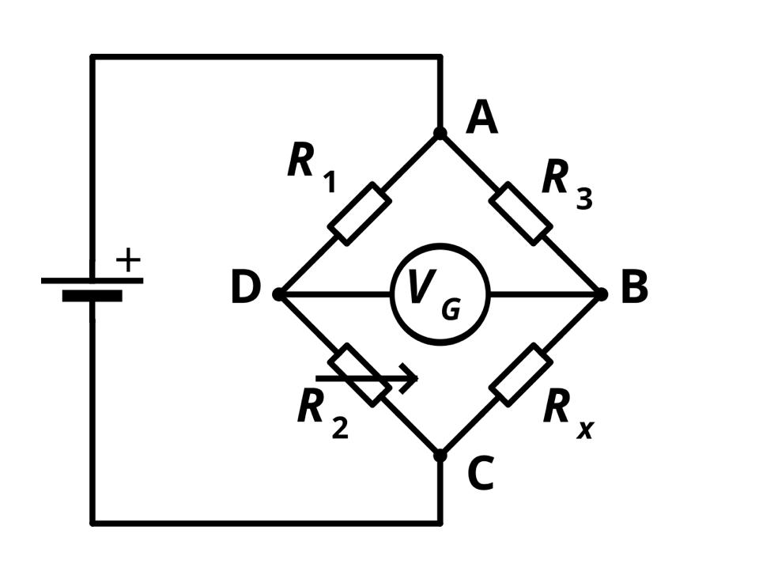

## How do they work?

When the gauge is deformed, usually by increasing or decreasing tension parallel to the substrate (thing on which it is placed), the electrical resistance changes. This change is usually measured using a wheatstone bridge, an electrical circuit that can measure the resistance value in an unknown piece (in our case the strain gauge).

The wheatstone bridge uses the known values of the resistances to calculate the unknown resistance. The formula is: Rx = R3 * R2 / R1. Derivation using Kirchhoff's Loop Rule (Voltage Law) and Current Law is given [here](https://en.wikipedia.org/wiki/Wheatstone_bridge#Full_derivation_using_Kirchhoff's_circuit_laws). However, this formula only works for a balanced bridge, which means that R2 must be adjustable. When all the 3 known resistors are fixed, there is another formula which uses the Voltage between D and B (VG) and the input voltage to calculate the value of Rx (also given in above link).

To calculate the length the strain gauge is tensioned by, this formula applies:
$\displaystyle GF={\frac {\Delta R/R_{G}}{\epsilon }}$ where $\epsilon$ is the strain on the gauge, given by the equation $\displaystyle \epsilon = \frac{\Delta L}{L}$. After calculating the gauge factor ($GF$) using tested values, the sensor is ready to be used in the field.

Afterward, the following equation is used to calculate $\epsilon$:
$\newline {\displaystyle SV=EV{\frac {GF\cdot \epsilon }{4}}}$

The Sensor Voltage $\displaystyle SV$ is recorded through the output of the wheatstone bridge and then the length can then be calculated from $\epsilon$.

## Advantages and Disadvantages of using an FPC

| Advantages | Disadvantages |
| ---------- | ------------- |
| Will be cheap and easy to remake | Likely is much more sensative to temperature/humidity changes |
| Can put many in different configurations together | Low accuracy |
| Add a reference strain gauge to the FPC | Needs to be calibrated before each run due to temperature and humidity concerns |

## Calculations

Using [this](https://www.omnicalculator.com/other/pcb-trace-resistance) calculator, I found the length at which the resistance is 350 $\Omega$.

I modified a script found on [github](https://github.com/vapetrov/PCB_strain_gauge/tree/main) using claude AI (AI was not used in the making of this project outside of this use case). This script uses a width as an input and creates a rectangle with a height that is found based on an inputed resistance of the trace. I created the axial strain gauges this way by splitting the circumference (50mm) in thirds. 

## Final Project

Then I created the schematic for the board. I went through many ideas throughout the course of the 3 weeks, from SPI ADCs with 3 In-Amps, to voltage shifting an ADC to allow for the differential input of the gauges to work with the PGA. I tried to focus on decreasing the cost and the BOM below \$10 per suspension member. I finally settled on using an I2C capable ADC with a PGA that can go up to 200x gain. To ensure that current of the ADC does not affect the strain gauges, I used Op-Amp buffers in a negative feedback loop.

Overall, the BOM is as follows:
| Part | Part Number | Cost |
| ---------- | ------------- | ------------- |
| ADC | ADS122C14 | $7.489 |
| Op-Amp | TLV4888DR | $1.620 |
| Misc. Caps + Resistors | N/A | $0.5 |

Total = $9.61

## KiCAD Project Walkthrough
The SVGs of the Strain Gauges are in the "StrainGaugeDesign" subfolder along with the footprint making python scripts.

On the first page of the KiCad schematic is the final schematic with all of the final parts that were mentioned above. The second page is a design with 2 In-Amps with a ADC without an PGA. However, this one was scrapped due to the high cost. The last page is an older design without buffers

The PCB design has all 4 of the strain gauges, the 3 axial ones and the reference one as well, but none of the other components have been added yet.

## ADC Comparison

| Part Number | Gain | SPS | Bits | Communication | Voltage | Notes | Cost | Link |
| ----------- | ---- | --- | ---- | ------------- | ------- | ----- | ---- | ---- |
| ADS122C14IRTER | 256x | 64k | 24 | I2C with 8 addresses | 1.74-3.6 | Originally picked; new shipment arrived?, in stock now | $7.489 on TI (MOQ 3k on digikey) | [here](https://www.ti.com/product/ADS122C14?keyMatch=ADS122C14IRTER&tisearch=universal_search&usecase=OPN)
| ADS131M04IPWT | 128x | 64k | 24 | SPI w/ individual CS | 2.7-3.6 | Simultaneous Sampling | $6.085 on TI or $7.94 on digikey (20-TSSOP package) | [here](https://www.digikey.com/en/products/detail/texas-instruments/ADS131M04IPWT/10434762) |
| MCP3564R | 64x | 153.6k | 24 | SPI w/ single CS for 4 + 1 more for up to 8 | 2.7-3.6 | first one sent on thread by Luca; Internal oversampling | $5.44 on digikey (20-TSSOP package) | [here](https://www.digikey.com/en/products/detail/microchip-technology/MCP3564RT-E-ST/12807301) |
| ADS124S08 | 128x | 4k | 24 | SPI w/ individual CS | 2.7-3.6 | None | $11.570 on TI or $13.23 on digikey (32-TQFP package) | [here](https://www.digikey.com/en/products/detail/texas-instruments/ADS124S08IPBSR/6569338) |
| ADS112S14 | 256x | 64k | 16 | SPI, can be daisy chained at under 60kSPS | 1.7-3.6 | Second one sent in thread by Amay | $6.348 on TI or $8.74 on digikey (16-WQFN package) | [here](https://www.digikey.com/en/products/detail/texas-instruments/ADS112S14IRTER/29184749?s=N4IgTCBcDaIIIBEDKBGFZUBYQF0C%2BQA) |
| ADS122S14 | 256x | 64k | 24 | SPI, can be daisy chained at under 60kSPS | 1.7-3.6 | Second one sent in thread by Amay | $7.489 on TI (MOQ 3k on digikey) (16-WQFN package) | [here](https://www.ti.com/product/ADS122S14) |

